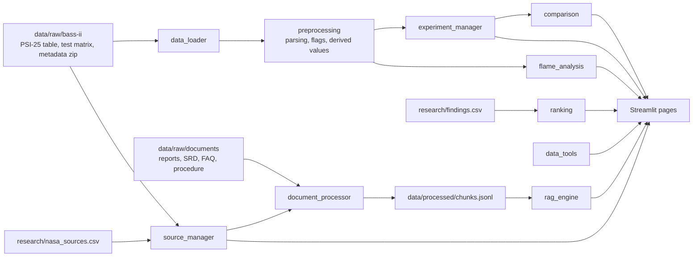

<p align="center">
  
</p>

<p align="center">
  
  
  
  
  
</p>

<!-- Live demo: add the Streamlit Community Cloud link here after deployment. -->

# FLARE Intelligence

**AI-Powered Microgravity Combustion Analysis and Space Fire Safety Insights**

NASA Space Apps Challenge 2026 | Team Techbees | Challenge: *Flame in Freefall: SI-Powered Fire Safety Insights from Microgravity Combustion Data*

FLARE Intelligence is a Streamlit research tool that turns NASA's BASS-II microgravity combustion records (investigation PSI-25) and the documents around them into something that can be explored, compared, questioned and checked. It is an **evidence-exploration tool**. It is not a fire-risk predictor and gives no fire probabilities.

**Contents:** [Abstract](#abstract) | [Problem](#problem-statement) | [Solution](#proposed-solution) | [Features](#key-features) | [Architecture](#technical-architecture) | [Data sources](#nasa-data-sources) | [Methodology](#methodology) | [AI](#ai-implementation) | [Install](#installation) | [Run](#running) | [Tests](#testing) | [Deploy](#deployment-streamlit-community-cloud) | [Team](#team) | [Limitations](#limitations) | [Future work](#future-improvements) | [Acknowledgements](#acknowledgements)

## Abstract

Microgravity combustion knowledge is spread over experiment tables, reports, slide decks and papers. FLARE loads the real PSI-25 (BASS-II) experimental table of 129 tests, flags the entries that cannot be used as numbers, and lets users filter, chart and compare tests. A document-grounded assistant answers questions by copying sentences from NASA documents together with their sources, and says so when the documents do not contain an answer. A findings page ranks documented findings with a transparent, adjustable score that measures how well a finding is documented, not how likely a fire is. Observations, interpretations and mission implications are kept apart, and every limitation we found is shown.

## Problem statement

Researchers and students who want to understand how flames behave in microgravity, and what that could mean for spacecraft fire safety, have to read long reports and decode raw tables whose columns, units and caveats are explained elsewhere. It is easy to mix up what was measured, what was interpreted and what was only hypothesised.

## Proposed solution

1. Show the measurements exactly as NASA recorded them, and label every value that FLARE parsed or calculated.
2. Make documents searchable with page-level sources and an honest "not enough information" answer.
3. Rank documented findings with a scoring method that anyone can read and re-weight.
4. Separate observations, interpretation and mission implications, and state why microgravity results do not automatically transfer to the Moon, Mars or other spacecraft.

## Challenge alignment

| Challenge goal | Where in FLARE |
|---|---|
| Explore NASA combustion experiments | Experiment Explorer |
| Analyse available measurements | Flame Analytics |
| Compare experiments | Experiment Comparison |
| Ask questions about NASA research | AI Research Assistant |
| Rank findings with transparent criteria | Findings Ranking |
| Implications for future spacecraft, Moon, Mars | Mission Insights |
| Import, validate and export data | Data Management |

## Key features

- **Overview**: counts computed from the loaded data only (tests, investigators, numeric sensor readings, documents, publications listed). An empty state is shown when data is missing.
- **Experiment Explorer**: search and filter the 129 tests; per-test record with fuel, conditions, sensor readings, derived values, quality flags and sources; study objective, hypothesis and approach from the PSI-25 metadata; links to the NASA page and DOI.
- **Flame Analytics**: distributions, scatter plots, initial-to-final charts, group comparisons and Spearman correlations (only with at least 10 pairs), with warnings when investigators or geometries are mixed. Variables that are not in the dataset are listed as unavailable.
- **Experiment Comparison**: side-by-side table and charts for 2 to 8 tests, "Not available" where a value is missing, and notes on differences that make a comparison hard to read.
- **AI Research Assistant**: TF-IDF retrieval over 471 passages from the BASS-II documents and PSI-25 metadata; answers are sentences copied from the passages with source and page; insufficient-evidence answers; optional local model through Ollama.
- **Findings Ranking**: 18 documented items (observations, interpretations, hypothesis, limitations); 11 are scored. Adjustable weights, a per-finding breakdown and a method section.
- **Mission Insights**: three separate tabs (observations, interpretation, potential implications) plus limits, topic by topic for lunar and Mars habitats, spacecraft interiors, crew safety, material selection and detection and suppression research.
- **Data Management**: upload CSV, JSON or XLSX; preview, column and missing-value report, layout check against the BASS-II table, optional cleaning with a log, export as CSV or JSON with a source file; import PDF or Word documents for the assistant (session only).

## Technical architecture



```
FLARE-Intelligence/
  app.py                      entry point (navigation)
  pages/                      00_Overview ... 07_Data_Management
  src/                        data_loader, preprocessing, experiment_manager, flame_analysis, comparison,
                              ranking, document_processor, rag_engine, source_manager, data_tools, ui, theme
  assets/                     banner
  data/raw/                   NASA files as downloaded (never edited)
  data/processed/             chunks.jsonl and other generated files
  research/                   nasa_sources.csv, findings.csv
  scripts/                    check and build scripts
  tests/                      logic tests and page tests
```

## Technology stack

Python (developed and tested on 3.10), Streamlit, pandas, NumPy, SciPy, scikit-learn (TF-IDF), Plotly, PyMuPDF, python-docx, openpyxl. No paid API and no API key is needed. An optional local language model can be used through Ollama (not tested by the team).

## NASA data sources

| Source | Identifier | Used for |
|---|---|---|
| NASA Physical Sciences Informatics, BASS-II | PSI-25, dataset DOI 10.60555/4qc4-de67 (from the PSI metadata file) | Experimental table, test matrix, metadata, FAQ, procedure, SRD, Summary Report |
| BASS-II Summary Report | NASA/TM-20210011385 (NTRS 20210011385) | Document search and findings |
| BASS-II results presentation | NTRS 20160000593 | Findings and source comparison (abstract only) |
| CSA-CP and CDM sensor paper | NTRS 20150019858, ICES-2015-196 | Listed as a source; not loaded |
| Saffire slides | NTRS 20180005168 | Listed; not loaded |
| SAFFIRE-I | PSI-98 | Not inspected |

The full list is in `research/nasa_sources.csv`. The zip file name says PSI-101 while the metadata inside says PSI-25; both are recorded and we did not resolve the difference.

**Data use:** we did not check the usage terms of the PSI files. Check them before redistributing the raw files in a public repository.

## Methodology

**Data layers.** Raw files are never edited. The cleaned table keeps every source value as text and adds parsed numbers, parsed fuel fields (material, geometry, thickness, rod diameter), derived differences (final minus initial) and a `quality_flags` column. Derived and parsed values are labelled as FLARE's own.

**Quality rules.** Entries such as `none`, `OR` (over range, above 1000 ppm) and `>500` are not turned into numbers. O2 values outside 10 to 25 % are flagged as possible data-entry errors (this range is our own screening choice, not a NASA limit) and are hidden from charts, not deleted. Date and GMT-day mismatches and unusual years are flagged. In the current table 18 of 129 tests carry flags.

**Analysis.** Gas columns hold one initial and one final reading per test, not time series. Correlations use Spearman rank correlation, require at least 10 complete pairs, and are shown with caveats (pooled fuels, reused samples, many comparisons). Example: thickness and CO increase correlate strongly across the pooled films and slabs (n = 39), but this mixes different experiments and is not evidence that thicker fuel causes more CO.

**Retrieval.** Documents are cut into passages of about 180 words with 40 words overlap; PDF passages never cross a page. Questions are matched with TF-IDF (word and word-pair statistics). A sentence is shown only if it is readable (no table dumps, fragments or reference entries) and contains one of the question's most distinctive words. If a name in the question is absent from the documents, or the best match is weak, the assistant says the documents do not contain enough information. A short word list (for example "habitat" to "spacecraft") widens the search and is shown to the user.

**Findings ranking.** Five criteria, each 0 to 3: relevance to spacecraft fire safety, strength of experimental evidence, availability of measurable observations, applicability to future missions (reviewer ratings recorded in `research/findings.csv`) and number of supporting sources (calculated). Score = 100 x sum(weight x level) / (3 x sum of weights). Only observations and interpretations are scored. The ratings are judgements; the current ones are marked draft and need team review. This is an evidence ranking, not a fire-risk prediction.

## AI implementation

The default assistant is retrieval-based: it does not generate text. Every answer is labelled as sentences copied from the documents, with passage sources, page numbers and a similarity score (word overlap, not a probability of being correct). If a local Ollama model is running and the user enables it, the model is instructed to answer only from the retrieved passages and to reply "INSUFFICIENT EVIDENCE" otherwise; its output is labelled as generated. Without a local model the app works unchanged.

Quality was checked on about ten test questions. Direct questions about objectives and hypothesis work well. Broader questions (for example the effect of microgravity on flames, or limitations) can return passages that only partly answer them, and the page then shows the passages instead of an answer.

## Installation

```
python -m venv venv
venv\Scripts\activate          # Windows PowerShell; on macOS/Linux: source venv/bin/activate
pip install -r requirements.txt
```

The NASA files must be in `data/raw/bass-ii/` and `data/raw/documents/` (see `research/nasa_sources.csv`). The 47 MB Summary Report PDF is not stored in the repository; to rebuild the passages from it, download it from PSI-25 and run `python scripts/build_chunks.py`. The prepared `data/processed/chunks.jsonl` is included so the app runs without it.

## Running

```
streamlit run app.py
```

## Testing

```
python tests/test_preprocessing.py
python tests/test_documents.py
python tests/test_rag.py
python tests/test_rag2.py
python tests/test_flame_analysis.py
python tests/test_experiments.py
python tests/test_ranking.py
python tests/test_data_tools.py
python tests/test_pages.py
python tests/test_assistant_page.py
python tests/test_app.py
python scripts/check_deploy.py
```

These are logic tests with small invented inputs (not presented as NASA data) plus headless runs of every page through the app navigation. They show that the code runs and behaves as designed; they do not prove that scientific statements are correct.

## Deployment (Streamlit Community Cloud)

1. Push the project to a public GitHub repository (run `python scripts/check_deploy.py` first).
2. On share.streamlit.io choose **New app**, select the repository and branch, and set the main file to `app.py`.
3. No secrets or API keys are needed. Choose a Python version in the advanced settings.

Files uploaded in Data Management are not stored permanently on a hosted app. The Ollama option does not work on a hosted app. Deployment has not been tested by the team yet.

## Team

**Team Techbees**

| Member | Responsibilities |
|---|---|
| **Hamna Munir** | NASA research and dataset inspection, preprocessing, scientific analysis, AI research assistant, findings and ranking, source validation |
| **Mirza Yasir Abdullah Baig** | Streamlit application, dashboard pages, visualisations, data management interface, GitHub, deployment |
| **Both** | Testing, scientific validation, documentation, final presentation |

<!-- The table shows the planned division of work. Edit it to match what each member actually did. -->

**AI assistance:** the code and documentation were developed with assistance from Claude (Anthropic) and then run and checked by the team. Check the challenge's current rules on declaring AI use.

## Limitations

- BASS-II ran in microgravity aboard the ISS. Lunar and Martian gravity are not covered.
- The table has no flame spread rate, flame length, burn duration, temperature or extinction column. The publications derived such quantities from video, which is not part of this app.
- Gas readings are one initial and one final value per test. The O2 sensor was out of calibration and corrected with a daily offset (BASS-II data FAQ); the hardware could not measure O2 throughout the experiment (Summary Report, PDF page 68).
- Sources give different maximum flow speeds (40, 53 and 55 cm/s in different documents); this was not resolved.
- Fuel text parsing is ours; materials are not always named (for example rods), and these rows show "not stated".
- Findings were written from the passages the team read (mostly conclusions and abstracts of the Summary Report). Ratings are draft and each finding rests on one or two sources.
- SAFFIRE (PSI-98) is not loaded. SAFFIRE questions are answered with "not enough information".
- The assistant does not understand questions; it matches words. Some questions return only partial answers.
- Small samples in a duct do not describe a fire in a whole compartment.

## Future improvements

- Load SAFFIRE-I data and documents and add a cross-experiment view.
- Read more of the Summary Report and the listed publications and add reviewed findings with independent sources.
- Team review of findings ratings; a second reviewer.
- Optional embeddings or a local model for better answers, evaluated on a fixed question set.
- Use the BASS-II videos or derived spread-rate data if they can be obtained legitimately.

## Acknowledgements

Data and documents: NASA Physical Sciences Informatics (PSI-25, BASS-II), NASA Glenn Research Center, the BASS-II investigators and the NASA Technical Reports Server. The Burning and Suppression of Solids-II experiment was run aboard the International Space Station using the Microgravity Science Glovebox. FLARE Intelligence is an independent hackathon project and is not endorsed by NASA.
